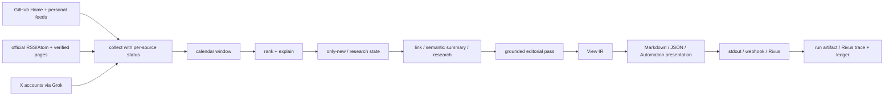

# Architecture

`rss-summary` is a local TypeScript CLI, a set of portable skills, and an external Rivus Plugin. Scheduling belongs to cron, launchd, systemd, Codex automation, or Rivus; the repository is not a hosted service.

## Module layout

The code base is one package with a shared kernel, four business modules, and one application layer that composes them into products:

```text
src/
  kernel/       shared Result type, time windows, text helpers (pure TS)
  acquisition/  where information comes from: the source-neutral Item model,
                source catalog rules, search budgets, and the adapters that
                translate RSS / listing pages / GitHub / Doubao / Grok / GLM
  reading/      what one URL says: the Document model, URL safety policy,
                text extraction, and the video → browser → HTTP → GLM chain
  editorial/    what is worth publishing: identity, subscription scoring,
                presentation depth, paper quota, news relevance and quotas,
                Daily AI categories, evidence validation, decisions
                (pure computation — no application/ or infra/)
  delivery/     what was sent and what is remembered: the delivered/researched
                ledger, Daily AI receipts, notifier, run archive storage
  app/          the consumer application: product flows (subscriptions,
                frontier, news, daily-ai, research), the Rivus plugin, the
                CLI, Markdown/Automation rendering, and configuration
```

Each business module follows the same internal shape (only the directories it uses exist):

```text
<module>/
  domain/<concept>/         the concept's pure model, split by building block
    value-objects/          types and value objects
    policies/               rules, thresholds, scoring, selection
    errors/                 typed failure values
    events/                 domain events emitted by transitions
    aggregates/             aggregate roots (SearchBudget is the only one)
    entities/               child entities inside an aggregate (SearchBudget's
                            cache entries; read only through the root)
    factories/              constructors assembling the model's inputs
    services/               stateless computation over several value objects
    adapters/               external formats → the concept's model (effect/Schema)
    index.ts                the concept facade; concepts reach each other through it
  application/              ports.ts (Context.Service) + use-cases/ + services/;
                            the root keeps only ports.ts and errors.ts
  infra/                    adapters/ (port implementations), repository/,
                            models/ (storage schemas), factories/ (layer
                            compositions), services/ (helpers shared inside infra);
                            no loose files at the root
  index.ts                  the module's public boundary
```

## Module boundaries

| Module | Answers | Owns | Never does |
| --- | --- | --- | --- |
| **kernel** | shared vocabulary | `Result`, time windows, text helpers | know about any module |
| **acquisition** | where information comes from | the source-neutral `Item`, source catalog rules, paper-source detection, `SearchBudget`, format adapters, fetching | decide what is worth publishing |
| **reading** | what this URL says | `Document`, URL safety, body extraction, the reader fallback chain | credibility or window judgments; depends only on kernel |
| **editorial** | what is worth publishing and at what depth | identity/dedup, scoring, presentation depth, paper quota, news funnel, Daily AI rules, evidence validation, reasoned decisions | any IO or state |
| **delivery** | what was sent and remembered | seen/researched ledger, only-new filtering, Daily AI receipts, notifier, run/diagnostics storage | content judgments |
| **app** | how products are assembled | product flows, Rivus protocol and session cache, CLI, rendering, env config, layer assembly | business rules that belong to a module |

Cross-module orchestration — "collect → rank → top up → deliver" — lives in `app/products/`. Modules never call each other's use cases, and products never import each other: composition shared by products lives in `app/products/shared/`. Daily AI composes two existing paths: acquisition's `collectXAccountPosts` for X accounts and the shared industry pipeline's `buildIndustryDocument` (`app/products/shared/industry.ts`) for official sources.

## Dependency rules

The machine-readable list is `scripts/architecture/boundaries.ts`; `tests/repo/architecture.test.ts` enforces zero violations across all of `src/` (including the sibling `*.test.ts` files, which may use `node:*`, Effect, and substitute layers but may not import another module's internals — cross-module imports go through `index.ts`).

Between modules:

| Module | May import |
| --- | --- |
| kernel | nothing |
| acquisition, reading, delivery | kernel |
| editorial | kernel; acquisition and reading (types only) |
| app | every module, through each module's `index.ts` only |

Inside a module:

| Layer | May import | Never |
| --- | --- | --- |
| `domain/<concept>/` | sibling concepts, kernel, upstream module types | `adapters/`, external packages (incl. Effect), `node:*`, IO, bare `Date.now()` / `new Date()`, source vocabulary (github, rss, doubao, grok, glm, arxiv, x.com) |
| `domain/<concept>/adapters/` | the module's domain and adapters, kernel, `effect/Schema`, parser libraries | `node:*`, IO, other Effect APIs |
| `application/` | the module's domain and adapters, kernel, Effect | the module's infra, `node:*`, `process.env`, `console` |
| `infra/` | the module's domain/adapters/application, kernel, Effect, `node:*`, allow-listed packages (Playwright only in the two browser adapters) | other modules' internals |
| `app/` | module `index.ts` files, kernel, Effect, `@rivus/agent`, `node:*` | module internals |

## Effect usage

- `domain/` (including adapters) is pure TypeScript. Failures return kernel `Result` values; validation errors with fixed messages are `Error` subclasses carrying a `_tag`. Adapters may use `effect/Schema` for decoding and nothing else from Effect.
- `application/` use cases return `Effect`. Ports are `Context.Service` with keys like `rss-summary/<module>/<Port>/v1`; the domain's `Result` values enter the error channel at the boundary.
- `infra/` implements ports as `Layer`s named `<Variant><Port>Live`. Acquisition HTTP goes through Effect's `HttpClient` over an injected `fetch`; the source catalog repository reads through the platform `FileSystem` (`@effect/platform-node`). The other state files use `node:fs` inside Effect: the search budget lock is held with `acquireUseRelease` and state writes run `uninterruptible`. Playwright sessions are managed with `acquireRelease`.
- `app/` assembles `AppLive` from the module layers and is the only place that runs effects: `Effect.run*` may appear in `src/app/runtime.ts` alone (test files excepted; enforced by the `effect-run` boundary rule). The CLI runs one `runPromiseExit` per command; the Rivus plugin builds a `ManagedRuntime` over `AppLive` for each execution (`src/app/layers.ts` assembles the layers).

## Product boundaries

The source type does not decide the product. The user's relationship to the source does:

| Product | Question | Sources | State |
| --- | --- | --- | --- |
| My subscriptions | What did sources I deliberately follow publish? | GitHub Home + `feeds.json` personal blogs | `.state/feed-state.json` |
| Industry frontier | What changed at companies and projects I should know about? | curated official RSS/Atom plus verified News / Changelog pages in `industry-feeds.json` | `.state/industry-state.json` |
| Noon/evening news | What happened in the last hours? | rotating event-specific Doubao/Grok queries from `news-topics.json`, with official/authoritative source policy | operational request budget + raw search cache |
| Daily AI Digest | What important AI events happened in the last 24 hours? | subscribed X accounts (Grok-compiled) + curated first-party `industry-feeds.json` sources with paper feeds excluded | delivery receipt + public evidence audit + shared news operational state |

Daily AI does **not** run a broad news search. X posts come from account-scoped Grok collection (`acquisition`'s `collect-x-posts` use case); the official half reuses the shared industry pipeline with paper sources removed before fetching. News search state is shared only because the X collection goes through the same budgeted search adapter.

GitHub Home belongs to subscriptions because it is already personalized. Public GitHub Repository Search and Hacker News discovery are intentionally not a product: they optimize for popularity and novelty rather than the user's explicit subscriptions or curated official sources.

## End-to-end flow



Every Markdown-producing product first builds a **View IR** (`src/app/render/view.ts`): a channel-independent structured document. Product layouts in `app/render/layouts/` turn product documents into the IR, and `app/render/markdown.ts` renders it. The Automation Presentation (`app/render/automation.ts`) is also a projection of the IR. Rivus passes the presentation hook only the Agent's reply text, so `automationPresentationForText` first decodes that Markdown back into a View IR (`app/render/view-decode.ts`, the inverse of the Markdown grammar) and then projects it. `--json` output is serialized directly from the product documents and does not pass through the IR.

The output depth is separate from ranking:

- `link`: a trusted but ordinary update is one sentence plus its original link.
- `summary`: RSS articles and pull requests always receive semantic space; other candidates expand for an explicit interest match or content-level importance marker (major/GA/breaking/deprecation/security). Repeated mentions, an announcement label, a score, or a release label alone never expands an item.
- `research`: papers are withheld from direct Markdown until the research workflow verifies the original source.

`src/editorial/domain/subscription/policies/presentation.ts` owns this decision. Renderers do not reinterpret scores.

Subscriptions and the frontier share one two-depth layout (`src/app/render/layouts/candidate.ts`); product layouts supply only labels and metadata. `selectCandidatePresentationSections` keeps every selected category instead of applying one global slice and caps each section: compact links at 20, expanded summaries at 20 for subscriptions and 8 (the default) for the frontier. Papers are counted but hidden from direct Markdown.

## Subscription workflow

The `morning-feed-digest` automation remains the scheduled **My subscriptions** product, preserving its stable ID and state history. Daily AI Digest uses the separate `daily-ai-digest` automation so deployments can bind both products without one replacing the other.

`rss-summary digest` runs this sequence:

1. Load GitHub Home configuration and `feeds.json`.
2. Fetch GitHub Home and every RSS feed independently. A failed source is recorded and does not erase successful sources.
3. Filter the explicit calendar day or rolling window.
4. Enrich GitHub candidates with followed users, repository metadata, and bounded PR details when credentials permit. Repository discovery remains grouped by repository; each PR and publication keeps a separate content identity.
5. Rank candidates and bound the paper queue.
6. Under `--only-new`, filter only previously delivered event IDs. Research cache entries do not suppress new subscription events.
7. Assign `link`, `summary`, or `research` presentation depth.
8. In Rivus, run the subscription Tool in three phases. `collect` returns typed evidence, `select` requires the model to decide whether every RSS/GitHub item is worth pushing with a reason, and the Agent uses the read-only `research-article` Tool for selected public URLs before writing per-item summaries. The RSS/GitHub collection, selection, deduplication and delivery path remains unchanged. `render` accepts those research results, filters to `selected=true`, and validates `Array<{ref, summary}>` plus grounded numeric claims. An empty selection is an auditable suppressed run rather than an empty card.
9. Render, deliver, record an audit artifact, then update seen state after successful non-dry delivery.

The CLI remains deterministic and renders source excerpts directly. The scheduled Rivus path adds the model editorial and bounded source-research pass only for selected subscription items. The industry frontier, noon/evening news, and Daily AI products retain their existing workflows; an already edited frontier headline is not summarized again by the subscription pass.

GitHub Home uses the saved `.state/github-home-storage.json` session. `GITHUB_HOME_FETCH=conduit` first reads GitHub's conduit response and falls back to a rendered browser page. `GITHUB_FEED_SOURCE=events` is the REST fallback.

## Frontier workflow

`rss-summary industry` never reads GitHub Home or `feeds.json`:

1. Load only `industry-feeds.json` or the isolated `INDUSTRY_SOURCES` override.
2. Fetch official RSS/Atom and configured listing pages independently and record source health.
3. Apply the time window and rank updates.
4. Require paper abstracts to match configured interests and cap the queue at `FEED_MAX_PAPERS` (hard maximum 8).
5. Under `--only-new`, filter delivered and researched identities with `.state/industry-state.json`.
6. Render ordinary updates as one line, expand high-quality updates, and withhold unresearched paper titles from Markdown.

The tracked frontier list deliberately excludes secondary daily aggregators and personal engineering blogs. A personal blog can still be excellent; it belongs in `feeds.json` because the user chose to follow it.

## Daily AI Digest workflow

The Daily AI Digest covers the rolling 24 hours before its scheduled occurrence and merges two evidence streams, both bounded by the exact half-open interval `[occurrence - 24h, occurrence)`:

- **Subscribed X accounts.** Each configured handle (`DAILY_AI_X_HANDLES`, default `ClaudeDevs`) is collected through the account-scoped Grok search with its own bounded instruction; no newsworthiness filter is imposed at collection. Posts carry the "Grok 整理" provenance and an unverified tier; per-handle audit (accepted counts, failures, Grok receipts, budget usage) is retained.
- **Official first-party sources.** The frontier collectors run restricted to `industry-feeds.json` sources whose feeds are not paper sources, with the same `since`/`until` bounds.

Evidence is normalized to public IDs, titles, canonical URLs, timestamps, cleaned excerpts and source tiers. Exact URL/title duplicates merge their references; semantic deduplication remains Agent-owned. The production Tool first returns evidence in a `collect` phase. The Agent decides what is newsworthy, translates or summarizes it, and chooses one of the six categories. `render` accepts structured `{category, headline, refs}` records and validates only their schema, category, length and known evidence references. Each record is validated independently, so a bad record cannot discard valid siblings. If all records are invalid while evidence exists, a typed validation error triggers a bounded retry against the cached snapshot; there is no title fallback or code-side keyword inference. The digest has no fixed item count; CLI updates need concrete changes and one item per tool. Version-only releases are omitted and an explicit empty editorial array is valid. Only `render` returns deliverable Markdown. Source references are rendered as clickable inline badges beside each event; repeated labels from the same provider collapse to one badge.

X collection and official-source collection are separate failure domains. Account failures are recorded in the audit and official evidence still produces the digest; generation fails only when all collectors yield no usable evidence, and configuration or programming errors are never degraded.

The shared news search adapter owns persistent request reservations and raw response caching for the X collection. Query selection, budget exhaustion and cache reuse remain visible in the public audit. Defaults, locking, fallback boundaries and deployment recovery are defined in [News search budget](news-search-budget.md).

## Research workflow

The deterministic CLI emits candidates; the portable `$feed-research-digest` skill and the scheduled Rivus `research-article` Tool perform source-based judgment:

```bash
rss-summary digest --json --only-new --dry-run
rss-summary industry --json --only-new --dry-run
```

Normal subscription/frontier entries need no deep research. The skill or Agent Tool spends attention on selected `summary` candidates and papers, opens the original article/repository/release/arXiv page, and keeps the extracted body bounded before editorial validation. Personal research cache avoids repeated investigation but does not hide later subscription events; frontier research state also participates in only-new filtering.

Reading implements a fixed fallback chain — video (captions/audio/key frames) → browser → HTTP → (when enabled) GLM — behind one `read-original` use case that enforces URL safety and the 80-character body minimum before any evidence is accepted.

## News workflow

The noon/evening news product keeps its own funnel because authority validation, topic quotas, time windows, and the eight-story cap differ materially from subscription ranking.

Its search configuration contains structured event intents rather than umbrella topics: a stable query ID, required subjects, required event terms, an intent code, explicit noise exclusions, and an allowed source class. The enabled query IDs rotate by local day and edition within a per-run cap. Requests cover the local calendar dates touched by the requested window, automatic query rewriting is disabled, and the application then applies the exact window and relevance policy to each result. The time filter protects delivery boundaries; it is not used as a substitute for a precise query.

News ranking uses within-query position, source authority, and freshness. A URL returned by multiple queries receives only a bounded tie-break bonus; it is not treated as independent corroboration. The Tool result carries a per-query audit with provider log ID, fetched/accepted counts, rejection reasons, canonical duplicate counts, semantic-title duplicate counts, quota filtering, and the eight-item cap.

The only search plugin interface is `SearchProvider`: `NEWS_SEARCH_MODE` switches between doubao, grok, hybrid, and combined, and the `withBudget` / `withRetry` decorators wrap any provider. Other readers and notifiers are plain ports with explicit dispatch in the use cases.

## Audit artifacts

Every CLI `digest` or `industry` run writes a paired artifact under:

```text
.state/runs/YYYY-MM-DD/<subscriptions|frontier>-HHMMSS-<run-id>.json
.state/runs/YYYY-MM-DD/<subscriptions|frontier>-HHMMSS-<run-id>.md
```

The JSON records:

- every source's success/failure, error, and fetched item count;
- fetched, in-window, ranked, selected, and research-pending counts;
- every ranked candidate's score, output depth, typed presentation reason/evidence, and selected/filtered decision;
- delivery status, channel, completion time, and failure message.

Inspect it with:

```bash
rss-summary runs list
rss-summary runs failures
rss-summary runs show <run-label-or-json-path>
```

`FEED_RUN_LOG_DIR` changes the root. The directory remains under `.state/` by default and must not be committed. Rivus Tools do not send messages or write business seen state; the news search adapter does persist its operational budget and raw response cache. Their structured result includes the source/candidate audit, while Rivus records actual card delivery in its trace and delivery ledger.

## State and storage

No database. Single user, small data volumes; the only multi-writer file (the search budget) is protected by a lock and atomic writes. State files must round-trip byte for byte; `tests/golden/state-roundtrip.test.ts` locks the formats against `tests/fixtures/state/`:

| File | Owner | Content |
| --- | --- | --- |
| `.state/feed-state.json` | delivery | subscription seen/researched ledger |
| `.state/industry-state.json` | delivery | frontier delivery/research state |
| `.state/news-search.json` | acquisition | news request budget + raw response cache (versioned, strict schema, sha256 cache keys); deployments set a persistent absolute path, see [News search budget](news-search-budget.md) |
| `.state/runs/` | delivery | append-only run audits |
| `.state/daily-ai/<sha256>-<phase>.json` | delivery | Daily AI phase snapshots for bounded retries |
| `.state/video-research/` | reading | transcripts, key frames, vision records |

- `--only-new --dry-run`: preview without changing seen/researched state; CLI still records a dry-run audit.
- `--only-new`: record delivered event IDs after successful output.
- `--json`: expose candidates plus audit for agent workflows.

## Test layout

Unit tests live next to the source file they exercise: `src/<module>/<path>/<name>.ts` pairs with `<name>.test.ts` in the same directory (`scripts/check-test-layout.mjs` enforces this; pure re-export and type-only modules are exempt). Package-level and cross-module tests stay under `tests/`: `golden/` (end-to-end snapshots and the plugin registration snapshot — the behavior lock), `fixtures/` (state files and documents), `repo/` (harness and repository contracts), and `support/` (suites shared by several adapters). Coverage excludes the sibling test files; the packed archive is asserted to contain no test code.

## Extension points

- Add a personal source with `rss-summary feeds add`; this changes `feeds.json`.
- Add a frontier RSS/Atom source when it is first-party. A `page` source additionally requires a same-origin path prefix, explicit dates, policy review, fixture coverage, and a live dry-run; edit `industry-feeds.json` intentionally.
- Adjust importance in `src/editorial/domain/subscription/policies/scoring.ts`; adjust display depth in `policies/presentation.ts` of the same concept.
- Add a source: a new format adapter under `acquisition/domain/item/adapters/` plus a port implementation under `acquisition/infra/adapters/`.
- Add a search provider: implement the `SearchProvider` port; `withBudget` and `withRetry` wrap it unchanged.
- Add a delivery channel: route the output through the View IR first, then extend the `Notifier` port.
- Add a host (CLI alternative, webhook service): a new directory under `app/` iterating the same product registry.
- Add semantic duplicate detection before ranking if canonical URL/title identity becomes insufficient.

## Known constraints

- GitHub Home parsing depends on GitHub's internal conduit/DOM shape.
- On machines that require `HTTP_PROXY`/`HTTPS_PROXY`, Node 24 must start with `NODE_USE_ENV_PROXY=1` for native fetch to use those variables.
- CLI summaries use feed/repository text unless the research skill has inspected the original source. Scheduled Rivus subscription summaries are model-edited from bounded PR/RSS evidence, and selected URLs can be upgraded with the Agent's bounded research result before validation; failed research falls back to source text only when the item remains explicitly selected.
- RSS identity dedupe is deterministic, not semantic.
- Official page ingestion depends on stable same-origin links and explicit date markup. Zero valid dated links is audited as parser failure instead of an empty day.
- The generic webhook cannot confirm downstream rendering; Rivus provides the stronger delivery ledger.
- The repository has no built-in daemon.
